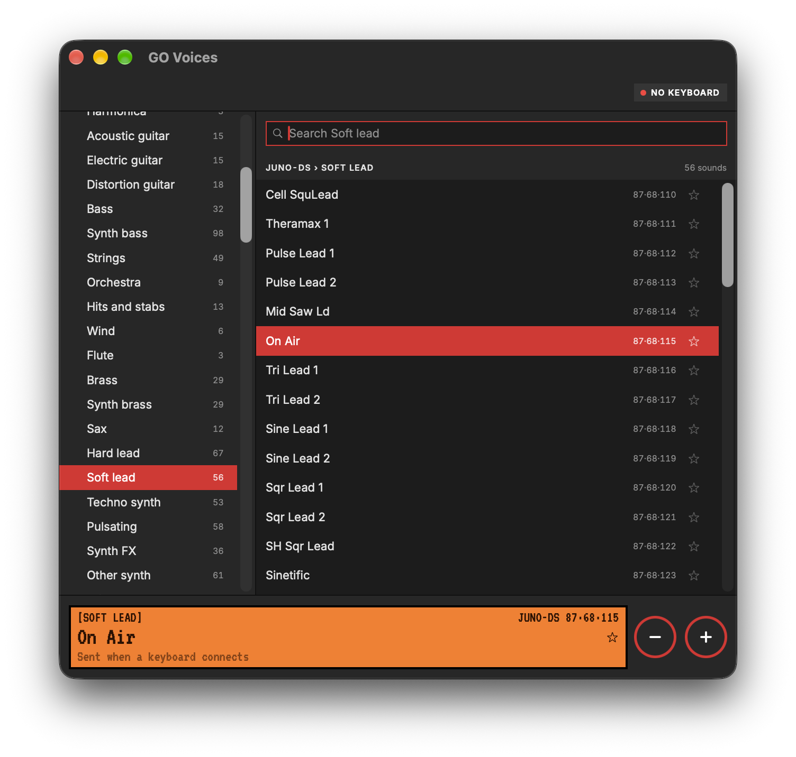

# GO Voices

Browse, search and pick any of the ~1,380 sounds a Roland GO:KEYS can play over MIDI (its JUNO-DS patches and the GM2 set), and send the pick to the keyboard over Bluetooth MIDI. Runs on iPhone, iPad and Mac.



The sound list comes from [GO:Plus](https://github.com/waldt/goplus)'s `GO-sounds.md` (see [Acknowledgements](#acknowledgements)). Selecting a sound sends bank select (CC 0 / CC 32) and a program change on the chosen channel (default 1).

## What it does

- **Browse and search** the sounds by bank and category, with favourites and recents. − / + step through the list.
- **Up to four parts** on a zone map: each part is a whole sound on its own range of keys. Drag either end of a part to set its keys: side by side they split the keyboard, overlapping they layer, and use + Part to split the part you're editing. Each part has its own display; tap one, or its band, to pick sounds for it.
- **Edit panel** for the half you're editing:
  - Mix: level, pan;
  - Play: octave, mono/poly, legato, glide, velocity;
  - Tune: temperament and key, coarse, fine, bend range;
  - Tone, Envelope and Vibrato offsets;
  - effect sends.
  
  For the whole keyboard: reverb and chorus on/off and level.
- **Layers:** edit the sound itself. Each of its up to four layers can be switched on or off, played alone, given another wave (step through them or search 1,045 by name), and tuned. Each layer also has a filter, filter, amp and pitch envelopes (with their shapes drawn), and two LFOs (vibrato, wah, tremolo, auto-pan). Each layer plays a range of keys and velocities, shown on its card and set by dragging on a drawn keyboard, so you can split a sound inside itself as the Combination sounds do. A layer can be copied and pasted onto another, even of another sound, from its card's menu. The app reads the sound from the keyboard first.
- **Presets:** save what's playing and bring it back in one tap. − / + step through them like a setlist.
- **Seamless switching** (optional): notes you're holding keep their sound when you pick a new one.
- **Everything is kept** between launches and sent again when the keyboard connects.

What the app writes to the keyboard, and what we found by trying it, is in [docs/go-keys-midi.md](docs/go-keys-midi.md).

## Layout

| Path | What |
|---|---|
| `catalogue/` | The sounds (`data/patches.tsv`), categories, banks, search. `no_std`. |
| `shared/` | The Crux core: the tree of places, search, selection, favourites and recents, the parts and their keys, the Edit panel's settings and their SysEx, saved settings, the view model. |
| `libs/crux-midi/` | MIDI device effects and the connection manager (list, connect, reconnect, scan, send). Shared with chord-detector, copied here so this repo builds on its own. |
| `shared_ffi/` | BoltFFI bridge and Swift type generator. |
| `apple/` | SwiftUI app for iOS 18 and macOS 15 (XcodeGen). |
| `tools/import-sounds/` | Rebuilds `patches.tsv` from `GO-sounds.md`. |

## Building

You need a Mac with:

- Xcode 16 or later
- Rust through [rustup](https://rustup.rs) (`rust-toolchain.toml` installs the targets)
- [`just`](https://github.com/casey/just), [`xcodegen`](https://github.com/yonaskolb/XcodeGen) and [`swiftlint`](https://github.com/realm/SwiftLint) (optional): `brew install just xcodegen swiftlint`
- [`cargo-nextest`](https://nexte.st): `cargo install cargo-nextest`
- the BoltFFI CLI, this exact version: `cargo install boltffi_cli@0.30.1`

`just apple doctor` checks the Apple tools.

```sh
just                 # fmt check, clippy (pedantic + nursery), tests
just check-nostd     # catalogue and core without std
just apple build     # Swift types, BoltFFI package, Xcode project, Mac + iOS simulator builds
just apple open      # generate, then open in Xcode
just import-sounds   # regenerate the catalogue (needs GO:Plus cloned next to this repo)
```

The Xcode project, the Swift packages and the generated types aren't committed: `just apple build` (or `just apple open`) makes them.

To run on an iPhone or iPad, put your Apple developer team in `apple/Local.xcconfig`. It isn't committed, and it survives regenerating the project:

```
DEVELOPMENT_TEAM = ABCDE12345
```

You'll also need a bundle identifier of your own: change `bundleIdPrefix` and `PRODUCT_BUNDLE_IDENTIFIER` in `apple/project.yml`. The Mac app and the simulator build without either.

## Pairing

- **iPhone/iPad**: tap the keyboard button at the top right ("No keyboard"), then *Pair Bluetooth keyboard…*. This opens the system's Bluetooth MIDI sheet. A keyboard paired once connects by itself afterwards.
- **Mac**: pair in Audio MIDI Setup (Window › Show MIDI Studio › Configure Bluetooth); the app connects to it.

## Acknowledgements

- **[GO:Plus](https://github.com/waldt/goplus)** by waldt (Apache License 2.0): the list of GO:KEYS sounds and their bank and program numbers in `GO-sounds.md`, which `tools/import-sounds` turns into `catalogue/data/patches.tsv` (what was changed is in [`catalogue/data/NOTICE`](catalogue/data/NOTICE)), and the research into what the GO keyboards accept over MIDI.
- **[GO Tone Bridge](https://github.com/madbadware/go-tone-bridge)** by madbadware (MIT License): the names of the waves the keyboard's sounds are built from (`catalogue/data/waves.tsv`, see its [`NOTICE`](catalogue/data/NOTICE)), and the knowledge that the GO:KEYS takes the JUNO-DS's whole patch map, which the Layers editor uses.
- **[Inter](https://github.com/rsms/inter)**, © 2020 The Inter Project Authors, and **[VT323](https://github.com/google/fonts/tree/main/ofl/vt323)**, © 2011 The VT323 Project Authors: both under the SIL Open Font License 1.1, bundled with their licences in `apple/GoVoices/Resources/Fonts/`.
- **[Crux](https://github.com/redbadger/crux)** by Red Badger (Apache License 2.0), for the core and its shell, and **[BoltFFI](https://crates.io/crates/boltffi)** for the Swift bridge.
- `libs/crux-midi` comes from chord-detector, where it was extracted from that app's MIDI connection handling.

Roland, GO:KEYS, GO:PIANO and JUNO-DS are trademarks of Roland Corporation. This app isn't affiliated with or endorsed by Roland.
